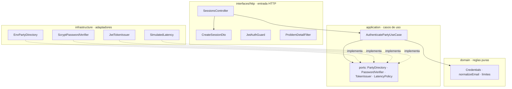
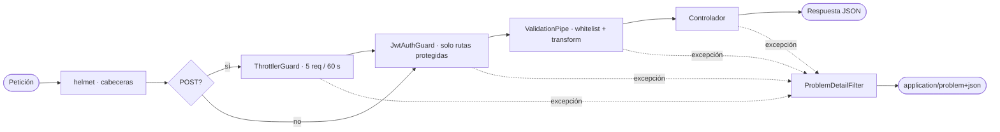
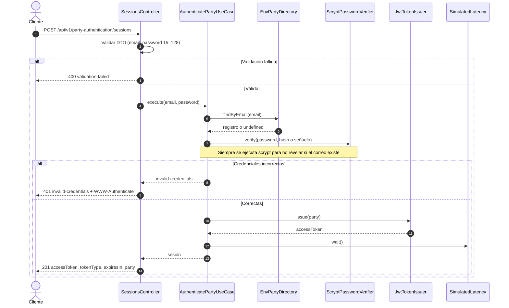

# KynWallet · Backend (API de autenticación)

API REST en **NestJS 12** que expone el flujo de inicio de sesión de la billetera. Las cuentas y el acceso están **simulados**: no hay base de datos y las credenciales se cargan desde variables de entorno.

Forma parte del monorepo `kynwalletPower`. El frontend Angular vive en [../frontend/](../frontend/) y se comunica solo a través de la API.

## Requisitos

| Herramienta | Versión |
|-------------|---------|
| Node.js | **24 LTS** (mínimo superior a 22) |
| npm | 11 o superior |

## Instalación y arranque

```powershell
cd backend
npm ci
npm run start:dev
```

> **Nota:** el backend **no lee archivos `.env`**. Las variables deben existir en el entorno del proceso. [.env.example](.env.example) sirve como referencia para definirlas antes de arrancar.

Con la configuración de ejemplo, la API queda en `http://localhost:3000/api/v1`.

## Variables de entorno

Definidas y validadas en [env.validation.ts](src/config/env.validation.ts). Si falta una variable obligatoria o tiene un formato inválido, el proceso no arranca.

| Variable | Obligatoria | Valor por defecto | Descripción |
|----------|-------------|-------------------|-------------|
| `PORT` | No | `3000` | Puerto HTTP. |
| `JWT_SECRET` | **Sí** | — | Secreto HS256. Mínimo 32 caracteres. |
| `JWT_ISSUER` | No | `kynwallet-backend` | Claim `iss` del token. |
| `JWT_AUDIENCE` | No | `kynwallet-web` | Claim `aud` del token. |
| `JWT_EXPIRES_IN_SECONDS` | No | `900` | Vigencia del token. Máximo 900 s. |
| `SIMULATED_LATENCY_MS` | No | `1000` | Retardo simulado en el login. Máximo 4000 ms. |
| `DEMO_ACCOUNTS` | **Sí** | — | JSON con las cuentas de demostración (ver abajo). |

### Formato de `DEMO_ACCOUNTS`

Lista JSON de cuentas. Cada contraseña se guarda como hash **scrypt**, nunca en texto plano. El correo se normaliza a minúsculas y sin espacios.

```json
[
  {
    "email": "demo@kynwallet.dev",
    "displayName": "Demo KynWallet",
    "passwordHash": "scrypt$16384$8$1$<salt-base64>$<clave-base64>"
  }
]
```

Restricciones: al menos una cuenta, sin correos duplicados y con un hash bien formado (sal de 16 bytes y clave de 64 bytes).

**Generar un hash** (parámetros N=16384, r=8, p=1, clave de 64 bytes):

```powershell
node -e "const c=require('node:crypto');const s=c.randomBytes(16);const k=c.scryptSync('tu-contrasena-larga-1',s,64,{N:16384,r:8,p:1,maxmem:64*1024*1024});console.log(['scrypt',16384,8,1,s.toString('base64'),k.toString('base64')].join('$'))"
```

Cada ejecución produce un hash distinto porque la sal es aleatoria.

## Scripts

| Script | Comando | Uso |
|--------|---------|-----|
| Compilar | `npm run build` | `nest build` a `dist/`. |
| Desarrollo | `npm run start:dev` | Recarga al guardar. |
| Producción | `npm run start:prod` | Ejecuta `dist/main`. Compilar antes. |
| Pruebas | `npm test` | Vitest, unitarias e integración. |
| Cobertura | `npm run test:cov` | Vitest con cobertura V8. |
| Lint | `npm run lint` | oxlint con tipos sobre `src/` y `test/`. |
| Pruebas en modo vigilancia | `npm run test:watch` | Vitest interactivo. |
| Depuración de pruebas | `npm run test:debug` | Vitest con inspector. |

## Arquitectura

El código sigue **Clean Architecture**: las dependencias apuntan hacia el dominio. Cada capa solo conoce a las de dentro.



| Capa | Carpeta | Responsabilidad |
|------|---------|-----------------|
| Dominio | `src/domain/` | Reglas de credenciales y normalización de correo. Sin dependencias de NestJS. |
| Aplicación | `src/application/` | Caso de uso de autenticación y puertos (interfaces). |
| Infraestructura | `src/infrastructure/` | Directorio desde entorno, scrypt, JWT y latencia simulada. |
| Interfaces | `src/interfaces/http/` | Controlador, DTOs, guards, filtros y errores RFC 9457. |
| Composición | `src/party-authentication.module.ts` | Inyección de dependencias y guards globales. |

Un test de arquitectura ([architecture.spec.ts](test/unit/architecture.spec.ts)) verifica que las capas no importen hacia fuera.

## Flujo de arranque y pipeline HTTP



El prefijo global es `api/v1`. `main.ts` valida el entorno antes de crear la aplicación.

## Flujo de inicio de sesión



Si el directorio falla, la API responde `503 service-unavailable`.

## Endpoints

Base: `/api/v1`. Contrato completo: [contracts/auth-api.md](../specs/001-login-billetera/contracts/auth-api.md).

| Método | Ruta | Protegido | Descripción |
|--------|------|-----------|-------------|
| `POST` | `/party-authentication/sessions` | No | Inicia sesión. Limitado a 5 solicitudes por minuto. |
| `GET` | `/party-authentication/sessions/current` | Bearer JWT | Devuelve la parte autenticada. |

### Cuerpo de la petición (POST)

```json
{ "email": "demo@kynwallet.dev", "password": "ejemplo-password-largo-1" }
```

El correo se normaliza a minúsculas. La contraseña debe tener entre 15 y 128 caracteres, según NIST SP 800-63B-4.

### Respuesta exitosa (201)

```json
{
  "accessToken": "<jwt>",
  "tokenType": "Bearer",
  "expiresIn": 900,
  "party": { "displayName": "Demo KynWallet" }
}
```

### Ejemplo con curl

```powershell
curl.exe -s -X POST http://localhost:3000/api/v1/party-authentication/sessions `
  -H "Content-Type: application/json" `
  -d '{"email":"demo@kynwallet.dev","password":"ejemplo-password-largo-1"}'
```

## Errores (RFC 9457)

Todas las respuestas de error usan `Content-Type: application/problem+json`. Los tipos se definen en [api-problem.exception.ts](src/interfaces/http/filters/api-problem.exception.ts) y se mapean en [problem-detail.filter.ts](src/interfaces/http/filters/problem-detail.filter.ts).

| Estado | `code` | Cuándo | Cabecera extra |
|--------|--------|--------|----------------|
| 400 | `validation-failed` | DTO inválido. Incluye `fields`. | — |
| 401 | `invalid-credentials` | Correo o contraseña incorrectos. | `WWW-Authenticate: Bearer` |
| 401 | `unauthenticated` | Falta el token o no es válido. | `WWW-Authenticate: Bearer` |
| 429 | `rate-limited` | Más de 5 intentos de login en 60 s. | `Retry-After: 60` |
| 503 | `service-unavailable` | El directorio no responde. | — |
| 404 | `not-found` | Ruta inexistente. | — |
| 500 | `internal-error` | Error no controlado. Sin detalles internos. | — |

## Seguridad

| Control | Implementación |
|---------|----------------|
| Cabeceras HTTP | `helmet()` en [configure-app.ts](src/bootstrap/configure-app.ts). |
| Token | JWT HS256 con `iss`, `aud`, `sub` y `exp`. El guard valida algoritmo, emisor y audiencia. |
| Vigencia | 900 s como máximo. |
| Fuerza bruta | `ThrottlerGuard` global: 5 solicitudes por 60 s, solo en `POST`. |
| Enumeración de cuentas | Se ejecuta scrypt aunque el correo no exista, usando un hash señuelo. |
| Contraseñas | scrypt (N=16384, r=8, p=1). Comparación con `timingSafeEqual`. |
| Entrada | `ValidationPipe` con `whitelist` y `forbidNonWhitelisted`. |
| Errores | Sin trazas ni mensajes internos en la respuesta. |
| Tiempo de respuesta | Latencia simulada máxima de 4 s. El frontend corta a los 4,5 s, por debajo del objetivo de 5 s. |

## Pruebas

```powershell
npm test          # unitarias e integración
npm run test:cov  # con cobertura
```

| Tipo | Ubicación | Qué cubre |
|------|-----------|-----------|
| Unitarias | [test/unit/](test/unit/) | Dominio, caso de uso, hash, directorio, configuración y arquitectura. |
| Integración | [test/integration/party-authentication.spec.ts](test/integration/party-authentication.spec.ts) | Endpoints HTTP completos con la aplicación Nest. |

Último resultado: 55 pruebas en verde (43 unitarias y 12 de integración). Cobertura sobre `src/`: 96,9 % en líneas y 87,7 % en ramas, con umbral obligatorio del 80 % definido en [vitest.config.ts](vitest.config.ts).

## Estructura

```text
backend/
├── src/
│   ├── bootstrap/            # configure-app (helmet, prefijo, pipes, filtros)
│   ├── config/               # validación de variables de entorno
│   ├── domain/               # reglas de credenciales
│   ├── application/          # caso de uso y puertos
│   ├── infrastructure/       # directorio, scrypt, JWT, latencia
│   ├── interfaces/http/      # controlador, DTOs, guards, filtros
│   ├── main.ts
│   └── party-authentication.module.ts
├── test/
│   ├── unit/
│   └── integration/
├── .env.example
└── vitest.config.ts
```

## Documentación relacionada

- [README raíz](../README.md): orquestador del monorepo.
- [Frontend](../frontend/README.md): cliente Angular.
- [Especificación](../specs/001-login-billetera/spec.md) y [plan](../specs/001-login-billetera/plan.md).
- [Contratos de API](../specs/001-login-billetera/contracts/auth-api.md).
- [Constitución](../.specify/memory/constitution.md).
