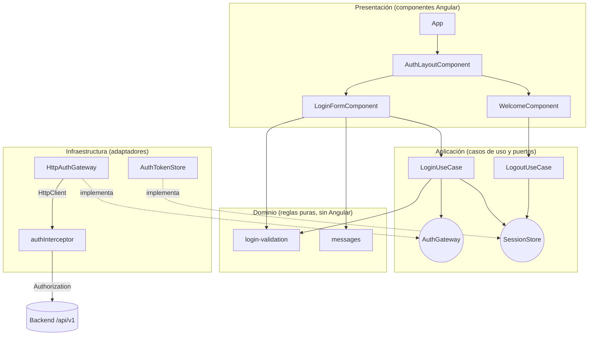
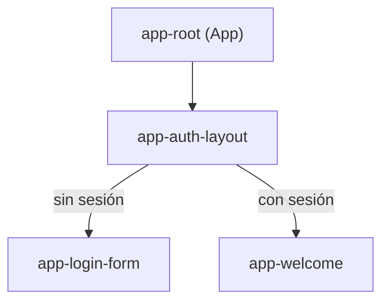
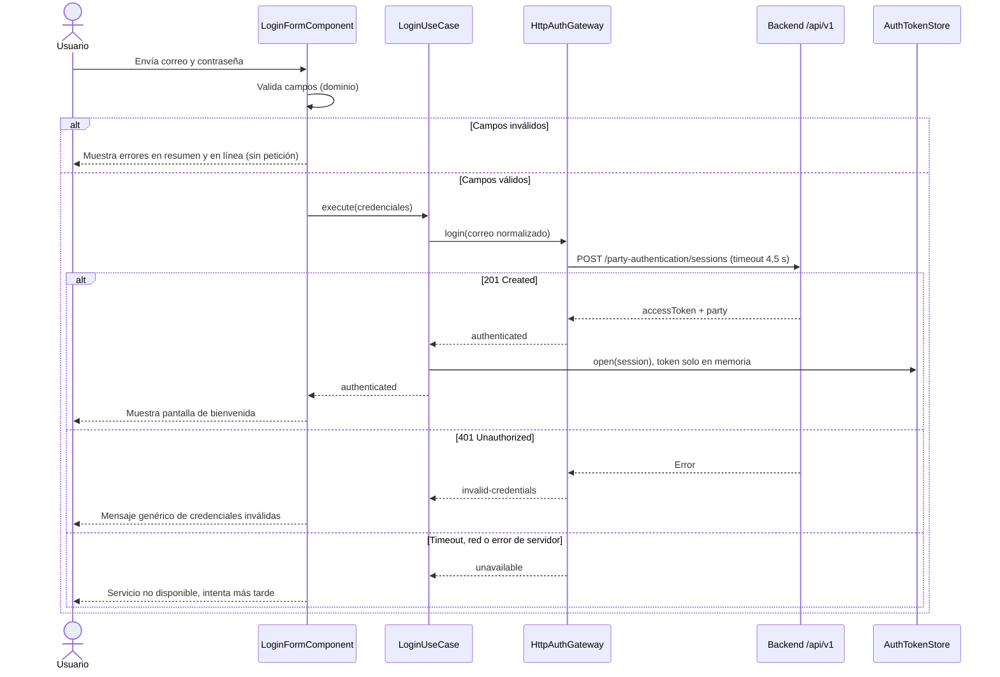

# KynWallet — Frontend (Angular)

Aplicación web de una sola página (SPA) con el formulario de inicio de sesión de KynWallet. Está construida con **Angular 22 (LTS)** y pruebas con **Vitest**, y consume las APIs mockeadas del backend NestJS.

> Documentación relacionada: [README raíz](../README.md) · [Backend](../backend/README.md) · [Especificación](../specs/001-login-billetera/spec.md) · [Plan](../specs/001-login-billetera/plan.md) · [Contrato de UI](../specs/001-login-billetera/contracts/ui-login.md)

## Requisitos

- Node.js **24 LTS** o superior (ver [.nvmrc](../.nvmrc)).
- npm 11 (versión fijada en `packageManager`).
- Para el modo desarrollo, el backend debe estar corriendo en `http://localhost:3000`.

## Puesta en marcha

```bash
npm install
npm start
```

Abre `http://localhost:4200/`. Las peticiones a `/api` se redirigen al backend mediante [proxy.conf.json](./proxy.conf.json), así que el navegador no hace llamadas cross-origin.

## Scripts

| Script | Comando | Descripción |
|---|---|---|
| `npm start` | `ng serve` | Servidor de desarrollo con recarga en caliente y proxy `/api`. |
| `npm run build` | `ng build` | Build de producción en `dist/`. |
| `npm run watch` | `ng build --watch --configuration development` | Build de desarrollo en modo observación. |
| `npm test` | `ng test` | Pruebas unitarias con Vitest y reporte de cobertura. |

## Estructura del proyecto

```text
frontend/
├── angular.json             # Configuración de build, serve y pruebas (umbral de cobertura 80 %)
├── proxy.conf.json          # Redirige /api al backend en desarrollo
└── src/
    ├── main.ts
    ├── styles.css           # Estilos globales
    ├── styles/tokens.css    # Tokens de color, espaciado y tipografía
    └── app/
        ├── app.ts, app.html, app.config.ts   # Raíz y proveedores (inyección de dependencias)
        ├── domain/          # Reglas de validación y mensajes (TypeScript puro)
        ├── application/     # Casos de uso y puertos (interfaces)
        ├── infrastructure/  # Adaptadores: HTTP, almacenamiento de sesión, interceptor
        └── presentation/    # Componentes: layout, login-form, welcome
```

## Arquitectura

El frontend aplica **Clean Architecture** con separación de responsabilidades por capas. Las dependencias apuntan hacia el dominio: la capa de presentación conoce los casos de uso, pero no las peticiones HTTP. La infraestructura implementa los puertos definidos en la capa de aplicación.



### Árbol de componentes

`App` muestra la pantalla de bienvenida o el formulario según exista una sesión. Ambos se renderizan dentro de `AuthLayoutComponent`.



## Flujo de inicio de sesión

Del envío del formulario a la respuesta del backend. Las validaciones de campos ocurren antes de cualquier petición.



## Seguridad

Controles implementados en el cliente. Complementan, no sustituyen, las validaciones del backend.

- **Token JWT solo en memoria.** `AuthTokenStore` guarda la sesión en una señal de Angular. No usa `localStorage` ni `sessionStorage`, así que reduce la exposición frente a robo desde el almacenamiento del navegador. Al recargar la página la sesión se pierde.
- **Interceptor de autorización.** `authInterceptor` añade el encabezado `Authorization: Bearer` solo a la ruta protegida y solo cuando hay sesión activa.
- **Validación de correo.** Se normaliza con `trim()` y minúsculas. Se valida con una expresión regular y una longitud máxima de 254 caracteres.
- **Validación de contraseña.** Entre 15 y 128 caracteres, según NIST SP 800-63B-4. No se imponen reglas de composición ni cambios periódicos.
- **Mensajes genéricos.** Ante un 401 se muestra un mensaje único de credenciales inválidas, sin indicar si falló el correo o la contraseña.
- **Tiempo de respuesta acotado.** `HttpAuthGateway` aplica un timeout de 4,5 s, por debajo del límite de 5 s de la constitución.
- **Autocompletado.** El campo de correo usa `autocomplete="username"` y el de contraseña `autocomplete="current-password"`.

## Diseño responsive

El layout se adapta a smartphone, tablet y escritorio. Los puntos de quiebre están en [auth-layout.component.css](./src/app/presentation/layout/auth-layout.component.css).

| Ancho | Perfil | Comportamiento |
|---|---|---|
| Menos de 480 px | Smartphone | Una columna, márgenes reducidos (16 px) y el formulario alineado arriba. |
| 480 px a 767 px | Smartphone grande | Una columna con el padding base del formulario. |
| 768 px o más | Tablet | Más padding en el panel del formulario (56 px vertical, 48 px horizontal). |
| 960 px o más | Escritorio | Grid de dos columnas (43 % marca, 1 fr formulario). El panel de marca se muestra completo. |
| 1280 px o más | Escritorio amplio | Columna de marca fija de 620 px y padding de 64 px. |

Por debajo de 768 px (smartphone) el panel de marca se oculta y solo se muestra el formulario. Entre 768 y 959 px el panel de marca se apila sobre el formulario y muestra solo el logotipo.

## Accesibilidad (WCAG AA)

- Cada campo tiene etiqueta asociada. Los errores se enlazan con `aria-invalid` y `aria-describedby`.
- El resumen de errores y los mensajes de autenticación usan `role="alert"`. Los avisos de estado usan `role="status"`.
- Durante la petición el formulario marca `aria-busy="true"`.
- El botón para mostrar u ocultar la contraseña usa `aria-pressed` y una etiqueta que cambia con el estado.
- Los elementos decorativos usan `aria-hidden="true"`.
- `app.spec.ts` ejecuta una auditoría automática con axe-core. La regla `color-contrast` está deshabilitada en jsdom porque no puede calcular colores.

**Pendiente:** verificar en navegador el contraste de colores (AA) y la experiencia de 320 px a 1920 px. Esta verificación manual aún no está hecha.

## Pruebas

```bash
npm test
```

- Ejecuta las pruebas de `src/**/*.spec.ts` con Vitest a través de `ng test`.
- La cobertura se mide sobre `src/app/**/*.ts`, excluyendo los archivos `.spec.ts` y `main.ts`.
- El umbral mínimo es del **80 %** en statements, branches, functions y lines. Si no se cumple, la ejecución falla.
- Último resultado registrado: 50 pruebas en verde y cobertura del 98 % sobre `src/app`.

## Pruebas end-to-end

No hay pruebas end-to-end en este proyecto todavía. El comando `ng e2e` no está configurado.

## Recursos

- [Angular CLI: referencia de comandos](https://angular.dev/tools/cli)
- [Vitest](https://vitest.dev/)
- [Especificación de la pantalla de login](../specs/001-login-billetera/contracts/ui-login.md)

